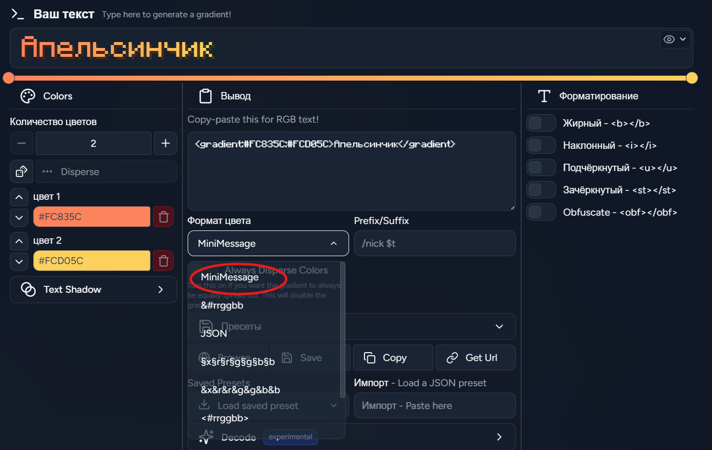
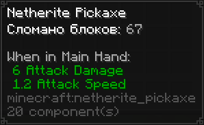

# Донаты

> **В этом разделе мы собрали список визуальных фишек, не влияющих на геймплей, которые можно приобрести на нашем [сайте донатов](https://donate.mkbuilders.ru/).**

`/donate` или `/donate menu` показывает ваши покупки, подписки, остатки ресурсов и общую сумму поддержки. Купленный эффект переключается нажатием в меню; некупленный ведёт на сайт. Ранг донатера выдаётся от 149 ₽ суммарно, спонсора — от 1500 ₽. Это отдельные ранги, а не срок подписки.

<!-- WIKI-IMAGE
ID: IMG-DONATE-001
TYPE: gui
DESCRIPTION: Личное меню донатов с купленным и выключенным эффектом и сроком подписки.
PURPOSE: Показать разницу между покупкой, активацией и подпиской.
-->

---

::heading[Брелки]{level="2" icon="../assets/name-tag.png" iconAlt="Брелки" iconWidth="40"}

Брелок — это особый кастомный предмет, который состоит из двух независимых частей: **Бирки** и **Датчика StatTrack**. Вы можете использовать их как по отдельности на разных предметах, так и повесить обе части на один!

### Бирка

Бирка позволяет покрасить название предмета и изменить его лор (описание). Для этого вам нужно перейти на сайт [Birdflop RGB](https://www.birdflop.com/resources/rgb) и создать свою комбинацию.

**Важное уточнение:** для того чтобы получить правильный тег, в поле «Format» необходимо выбрать «**MiniMessage**».

С полученным тегом из поля «Output» (Вывод) обратитесь к любому администратору на сервере или в Discord, обязательно уточнив, на какой конкретно предмет вы хотите наложить переименование.

Если доступ к переименованию уже выдан, держите предмет в основной руке. `/rename name <текст>` меняет имя, `/rename lore <номер> <текст>` — строку описания с номером от 1 до 10. Поддерживается MiniMessage. Эти команды сами не расходуют остаток переименований или клюкву: покупка услуги и право на команду — не одно и то же.

### Датчик StatTrack

{width=50%}

Ещё один способ покрасоваться циферками, но теперь уже на собственных инструментах. "Стат-трэк" записывает статистику предмета прямо в его описании.

Если вам выдан доступ к команде, возьмите предмет в основную руку и выполните `/stattrack`. Пустая рука не подойдёт. Сама команда не списывает клюкву или остаток переименований.

| Счётчик | Что учитывается |
| --- | --- |
| Сломано блоков | Разрушенные вами блоки |
| Убито существ | Засчитанные вам убийства |
| Нанесено урона | Фактический урон прямыми ударами и вашими снарядами |
| Выпущено снарядов | Стрелы, спектральные стрелы, трезубцы и фейерверки |
| Поймано рыбы | Успешные уловы |
| Заблокировано урона | Разница между входящим и фактическим уроном на надетой броне |

Первые пять счётчиков обновляют отмеченный предмет в основной руке в момент события. Это не строгая привязка к типу инструмента: при попадании снаряда важна уже текущая рука. Заблокированный урон целиком записывается на каждую надетую часть брони со Стат-трэком, а не делится между ними.

Статистика сохраняется на предмете. При обновлении счётчиков его описание заменяется строками статистики — заранее согласуйте отдельный лор и Стат-трэк, если хотите сохранить оба.

---

## Донатные эффекты

::image{src="../assets/nightmare.png" alt="Эффект Кошмар" width="400"}

Выделитесь из толпы с помощью уникальных визуальных эффектов! Это тематические наборы частиц, которые будут красиво витать вокруг вашего персонажа. Они не создают помех при игре и не меняют хитбоксы, но отлично дополняют ваш игровой образ.

Помимо покупки за реальные деньги, часть эффектов можно приобрести за игровую валюту — **клюкву**. Она выдаётся на отдельных событиях; наличие постоянного способа заработка не гарантируется. `/cranberryshop` показывает баланс и доступные покупки. Уже купленный эффект повторно не оплачивается, а при нехватке клюквы покупка не проходит.

| Эффект | Как выглядит | Клюква |
| --- | --- | --- |
| Пение | Ноты и частицы тотема | 990 |
| Сакура | Лепестки вишни | 990 |
| Искры | Частицы фейерверка | 990 |
| Зевс | Дым у ног и сердитые частицы вокруг головы | 1490 |
| Проклятие | Зловещие частицы испытаний и рейда | 1490 |
| Чары | Частицы портала, драконьего дыхания и ведьмы | 99 |
| Мысли | Сходящиеся частицы зачарования | 99 |
| Небо Помпеи | Дым костра и капли лавы | 99 |
| Хэллоуин | Пламя, оранжевые и зловещие частицы | Не продаётся за клюкву |
| Кошмар | Синее пламя, души и дым | Не продаётся за клюкву |
| Рождество | Белые и красные частицы, облачка | 1490 |
| Звёздный дождь | Изредка падающая золотая звезда | Подписка |
| Спутник | Маленький тёмный спутник вокруг игрока | Подписка |
| Аура рыбака | Кольцо-сонар в воде и брызги | Награда завершённого сезона |

Выберите купленный эффект в `/donate` или используйте `/donate toggle <эффект>` с подсказкой команды. Косметика не усиливает атаки и не меняет хитбоксы. У невидимого игрока и в режиме наблюдателя эффекты не показываются. Сезонное название само по себе не означает ежегодную выдачу.

---

## Подписки

На проекте существует две ступени подписок: **Звезда** и **Спутник**.
**Спутник** находится выше по иерархии и включает в себя весь функционал Звезды, за исключением её эксклюзивного эффекта.

Один месяц подписки — 30 дней. Продление добавляет срок к ещё действующей подписке, а не начинает его заново со дня покупки. Дату окончания можно посмотреть в `/donate`. После окончания подписки её роль и связанный эффект снимаются.

### Звезда

Базовая подписка, открывающая приятные возможности для кастомизации:

- **Кастомный статус в табе** — выделите себя по-новому.
- **Команда `/hat`** — позволяет надеть любой блок или предмет себе на голову.
- **Эффект «Звезда»** — эксклюзивный эффект, доступный только для этой подписки.

Держите предмет в основной руке: `/hat` меняет его местами с содержимым слота головы, а не уничтожает надетый шлем.

### Спутник

Лучшая подписка, дающая максимум визуальной свободы:

- *Включает весь функционал подписки «Звезда» (кроме эффекта «Звезда»).*
- **Цветной чат** — возможность писать в чате любыми цветами с использованием форматирования MiniMessage.
- **Кастомный никнейм** — полное изменение отображаемого имени (в чате, в табе, в профиле).
- **Эффект «Спутник»** — уникальный косметический эффект, доступный только для этой подписки.

Собственный ник меняется командой `/nickname set <имя>` (до 16 символов), сбрасывается через `/nickname reset`. Помимо роли, на сервере должно быть включено использование кастомных ников; если команда недоступна, уточните это у администрации. Другие игроки могут включить показ настоящих ников в [тогглах](/feature/toggles).

---

::heading[Кастомные пластинки]{level="2" icon="../assets/music-disc.png" iconAlt="Кастомные пластинки" iconWidth="40"}

Кастомные пластинки позволяют записать на них любую свою музыку и прослушивать в игре. Для её прослушивания вам и вашим друзьям потребуется установленный на клиенте мод [PlasmoVoice](/feature/plasmo-voice).

Чтобы записать музыку, нужно иметь обычную пластинку в виде предмета в игре и обратиться к кому-либо из администраторов, чтобы они "нарезали" музыку на вашу пластинку.

---

::heading[Музыкальные рога]{level="2" icon="../assets/goat-horn.png" iconAlt="Музыкальные рога" iconWidth="40"}

Музыкальные (козьи) рога работают по схожему с пластинками принципу, но отлично подходят для коротких звуков, забавных фраз или мемов. На рог можно записать любой аудиофрагмент **длительностью до 10 секунд**.

Как и в случае с пластинками, воспроизведение звука работает через мод [PlasmoVoice](/feature/plasmo-voice), поэтому он должен быть установлен у вас и окружающих игроков.

Для создания такого рога вам понадобится обычный козий рог. Обратитесь к любому администратору сервера, и он поможет записать нужный звук на ваш предмет.
