# Достижения

Зачастую, нам нечем заняться лишь потому что у нас нет четкой цели.
Именно поэтому на нашем сервере присутствует датапак на кастомные достижения
Список всех существующих на данный момент достижений и условия их выполнения перечислены ниже:

Достижения появляются во вкладке MakeABuilders, когда на сервере включён соответствующий датапак. Условия ниже описывают фактическое выполнение: отдельные старые карточки могут отличаться от него. Отдельно существуют шесть включаемых [челленджей](/feature/challenges).

## Привет, MakeABuilders!

Зайдите на сервер с включённым датапаком. Отдельная команда не нужна.

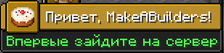{width=50%}

## Кто здесь главный?

Убейте Дракона Края, Визера, Вардена и древнего стража. Не обязательно за одну жизнь.

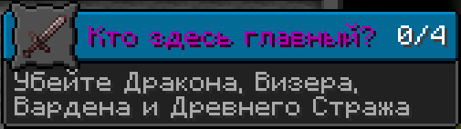{width=50%}

## Зомбиапокалипсис

Съешьте 20 кусков гнилой плоти подряд, не перебивая другой едой.

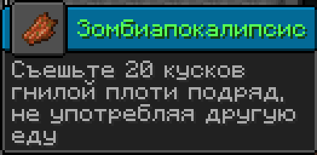{width=50%}

## Фермер на максималках

Посадите пшеницу, морковь, картофель, свёклу, арбуз, тыкву, какао, адский нарост, сладкие и светящиеся ягоды, факельник и кувшинницу. Нужна именно посадка, а не сбор урожая.

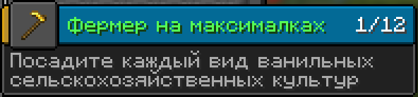{width=50%}

## Бессмертный

Проведите 5 минут подряд в лаве Незера без брони и Огнестойкости. Выход из лавы или измерения, надетая броня и Огнестойкость сбрасывают попытку. Зачарованное золотое яблоко с Огнестойкостью тоже не подойдёт.

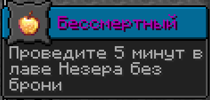{width=50%}

## Бесполезней некуда 2.0

Получите деревянную мотыгу с Эффективностью V, Прочностью III, Починкой I и одним из двух зачарований: Удачей III **или** Шёлковым касанием I. Всё должно быть на одной мотыге.

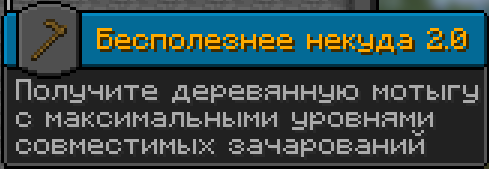{width=50%}

## Пьяный гений

Одновременно соберите 34 эффекта: Поглощение, Дурное знамение, Слепоту, Дыхание наутилуса, Морскую силу, Тьму, Грацию дельфина, Огнестойкость, Свечение, Спешку, Героя деревни, Голод, Заражение, Невидимость, Прыгучесть, Левитацию, Утомление, Тошноту, Ночное зрение, Слизистость, Отравление, Знамение рейда, Регенерацию, Сопротивление, Плавное падение, Замедление, Скорость, Силу, Знамение испытания, Подводное дыхание, Слабость, Плетение, Заряд ветра и Иссушение. Один только «Герой деревни» не засчитывает достижение.

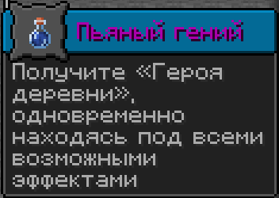{width=50%}

## Спидранер

Используйте кровать в Крае во время убийства Дракона. Смерть должна попасть в минутное окно после использования; личный последний удар именно взрывом кровати отдельно не требуется.

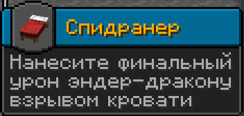{width=50%}

## Та самая иголка!

Добейте вызывателя **ударом рукой**, держа стрелу либо кусочек железа. Выстрел из лука не подойдёт.

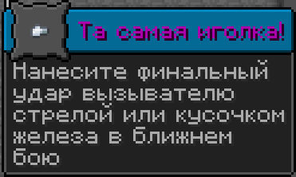{width=50%}

## Снегопад

Попадите снежками по трём кристаллам Края во время боя с Драконом. Проверяется близкий пролёт снежка у кристалла, а не обязательное уничтожение каждого кристалла.

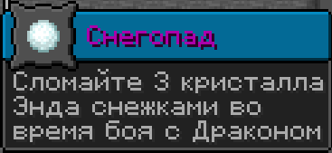{width=50%}

## Мягкая посадка

Упадите с высоты **больше 50 блоков** на блок слизи без получения урона. Ровно 50 недостаточно.

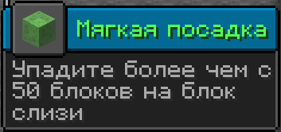{width=50%}

## Узник кузнеца

Используйте наковальню 250 раз. Ломать десять наковален не требуется — старое описание карточки неверно.

<!-- WIKI-IMAGE
ID: IMG-ACHIEVEMENT-001
TYPE: gui
DESCRIPTION: Актуальная карточка Узник кузнеца с условием 250 взаимодействий с наковальней.
PURPOSE: Заменить старую карточку, ошибочно обещавшую десять сломанных наковален.
-->

## Эко-транспорт

Проедьте на свинье суммарно 1000 блоков. Оседлайте её и управляйте удочкой с морковью.

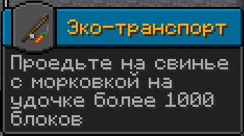{width=50%}

## Кощей бессмертный

Проведите в игре 100 часов с последней смерти. Это ванильное время выживания, а не включаемый челлендж.

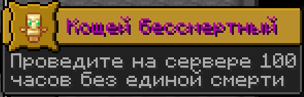{width=50%}

## Библиотекарь

Соберите книги со всеми 43 зачарованиями, включая оба проклятия, Порыв ветра, Плотность, Пробитие и Выпад. Уровень не важен, но зачарование должно быть на книге, а не на инструменте. Прогресс сохраняется по каждому виду — не нужно держать всё одновременно.

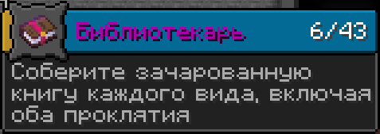{width=50%}

## Железнодорожник

Поставьте суммарно 5000 рельсов. Складываются обычные, электрические, нажимные и активирующие рельсы.

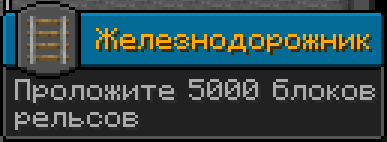{width=50%}

## Шеф-повар

Съешьте печёный картофель, стейк, жареную курицу, треску, баранину, свинину, крольчатину, лосося, тушёного кролика и тушёные грибы. Нужны все десять, а не любые десять блюд.

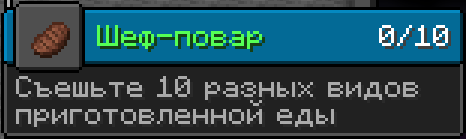{width=50%}

## На ощупь

Пройдите 200 блоков ночью с полностью пустыми инвентарём, хотбаром, бронёй и второй рукой. Бег и приседание тоже учитываются. Дневное время или появившийся предмет сбрасывают текущую попытку.

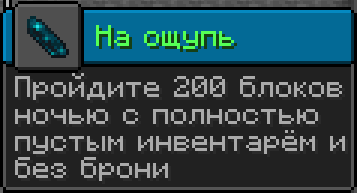{width=50%}

## Пчеловод

Соберите Шёлковым касанием пять ульев или пчелиных гнёзд. В каждом должна быть хотя бы одна пчела.

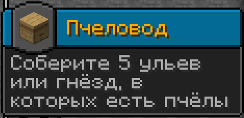{width=50%}

## Мастер триков

Спаситесь ведром воды после падения минимум на 96 блоков. Поставьте воду перед приземлением: проверка воды у ног действует около 2 секунд после использования ведра. Прыжок со 100 блоков тоже подходит, но это не минимальная высота.

<!-- WIKI-IMAGE
ID: IMG-ACHIEVEMENT-002
TYPE: gui
DESCRIPTION: Карточка Мастер триков, согласованная с фактическим порогом падения 96 блоков.
PURPOSE: Не повторять старый завышенный порог из изображения.
-->

## Меломан

Получите все 22 пластинки: 5, 11, 13, Blocks, Bounce, Cat, Chirp, Creator, Creator (Music Box), Far, Lava Chicken, Mall, Mellohi, Otherside, Pigstep, Precipice, Relic, Stal, Strad, Tears, Wait и Ward. Их не обязательно хранить одновременно. [Копирование пластинок](/feature/recipes) — отдельные рецепты.

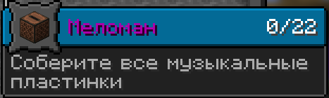{width=50%}

## Летающий дантист

Убейте фантома прямым попаданием брошенного трезубца, пока сами планируете на элитрах. Молния вместо прямого попадания не заменяет условие.

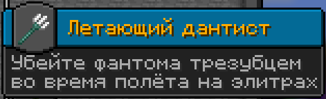{width=50%}

## Садовник

Получите одуванчик, мак, синюю орхидею, лук, хаустонию, четыре цвета тюльпанов, ромашку, василёк, ландыш, розу Визера, факельник, открытый и закрытый глазоцвет, золотой одуванчик, подсолнух, сирень, розовый куст, пион и кувшинницу. Кроме цветов нужны цветущая азалия и её листва, мангровый отросток, вишнёвая листва, розовые лепестки, полевые цветы, цветок хоруса, спороцвет и цветок кактуса. Прогресс каждого предмета сохраняется отдельно.

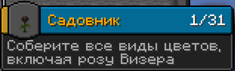{width=50%}

## Вокруг света

Пройдите суммарно 50 000 блоков: ходьба, бег и движение в приседе складываются. Полёт и поездки не заменяют пеший путь.

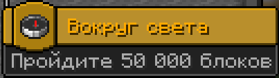{width=50%}

## Баннермейкер

Скрафтите знамёна десяти разных базовых цветов. Разные узоры на одном цвете не дают новые зачёты.

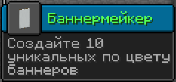{width=50%}

## Палач

Получите головы игрока, крипера, зомби, скелета, скелета-иссушителя, Дракона и пиглина. [Голова игрока](/feature/custom-items) выпадает при убийстве другим игроком.

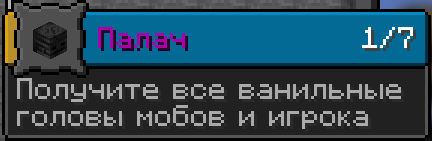{width=50%}

## Живи на краю

Переживите падение минимум на 20 блоков, оставшись не более чем с половиной сердца.

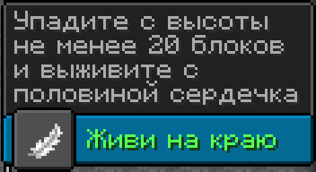{width=50%}

## Башня до небес

Поставьте блок на Y=511 в [обычном мире](/feature/world).

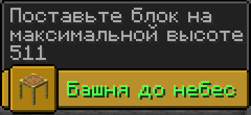{width=50%}

## Гроза деревень

Ударьте жителя, когда железный голем находится не дальше 16 блоков. Убийство жителя не требуется.
