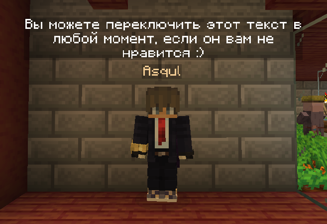

# Сообщения над головой

Будьте правильными! Не отводите глаз в сторону при диалоге с человеком, ведь теперь текст, сказанный игроками, появляется над их головой. Но, если вам не нравится такое, это всё ещё настраивается через /toggle

`/toggle bubble-messages` управляет появлением **ваших собственных** сообщений над головой. Одновременно держится до трёх сообщений примерно по 5 секунд; четвёртое вытесняет старое. Это работает с общим чатом, а не с личной перепиской.

Игнор и выключение общего чата не гарантируют скрытия чужих сообщений над головой. [Режим стримера](/feature/streamer-mode) фильтрует их отображение для зрителя отдельно.

