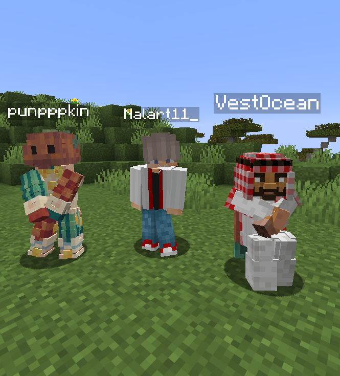

# Emotecraft

Танцуйте! Позируйте! Выражайтесь!
С Emotecraft расширяются возможности взаимодействия друг с другом, позволяя более удобно выражать свои эмоции и показывать прикольчики друг другу; главное — иметь предзагруженные эмоции.

Для этого нужен клиентский мод: одна лишь поддержка на сервере не добавляет меню эмоций в обычный Minecraft. Чтобы видеть анимации друг друга, Emotecraft должен быть установлен и у вас, и у других участников.

## Установка

1. Проверьте версию Minecraft и загрузчик своей сборки. Мод для Fabric не подойдёт к Forge или NeoForge, даже если версия игры совпадает.
2. Скачайте [Emotecraft с Modrinth](https://modrinth.com/mod/emotecraft) под свою версию игры и загрузчик. На странице выбранного файла проверьте обязательные зависимости и установите их тоже: у разных версий они различаются.
3. Положите скачанные `.jar` в папку `mods` именно той сборки, с которой заходите на сервер. Лаунчеры могут хранить каждую сборку отдельно — общая `.minecraft` не всегда нужное место.
4. Полностью перезапустите игру. В настройках управления найдите назначения Emotecraft: это заодно позволит убедиться, что мод загрузился.

На Fabric для доступа к настройкам мода через список модов можно дополнительно установить Mod Menu. Это удобный способ открыть настройки, а не замена самому Emotecraft.

Не скачивайте мод с сайтов, предлагающих отдельный «установщик эмоций». Официальные загрузки перечислены в [репозитории Emotecraft](https://github.com/KosmX/emotes).

## Первый запуск

По умолчанию быстрое меню открывается клавишей **B**. Если ничего не происходит, проверьте назначение Emotecraft в настройках управления Minecraft и конфликты с другими модами. Можно выбрать другую свободную клавишу.

В быстром меню выберите эмоцию из колеса. Если нужной там нет, откройте общий список эмоций — в английском интерфейсе пункт называется **All emotes**. Найдите анимацию по названию и запустите её оттуда.

Для проверки переключитесь на вид от третьего лица через **F5**. От первого лица собственную позу легко не заметить. Сначала стойте на месте: движение может прерывать анимацию, а короткая эмоция просто закончится сама.

Названия кнопок и вид меню зависят от версии и языка мода. Если вместо отдельного нажатия колесо открывается только при удержании клавиши, проверьте выбранный режим быстрого меню в настройках Emotecraft.

## Своё колесо эмоций

Откройте настройки Emotecraft. На Fabric с Mod Menu это список модов, затем Emotecraft и кнопка настройки. Внутри быстрого меню также может быть переход к настройкам — ориентируйтесь на установленную версию.

В классическом меню, показанном в официальном руководстве, настройка выглядит так:

1. Найдите эмоцию в общем списке и выделите её. Поиск помогает не пролистывать всю коллекцию.
2. Нажмите на нужную ячейку быстрого меню, чтобы назначить туда выбранную эмоцию.
3. Повторите для остальных ячеек, затем вернитесь в игру и проверьте колесо через **B**.

В интерфейсе, описанном в [руководстве Emotecraft](https://kosmx.gitbook.io/emotecraft/manual/the-menu), ПКМ по ячейке убирает из неё эмоцию. Сам файл при этом не удаляется: анимацию можно назначить заново.

<!-- WIKI-IMAGE
ID: IMG-EMOTECRAFT-001
TYPE: sequence
DESCRIPTION: Выбор эмоции и её назначение в ячейку, затем заполненное быстрое меню в игре.
PURPOSE: Различить настройку колеса и запуск уже назначенной эмоции.
-->

Необязательно открывать колесо для каждого жеста. В настройках можно выделить эмоцию, выбрать поле её клавиши и нажать нужную кнопку. Проверьте, чтобы она не была занята чатом, инвентарём или другим модом. В описанном руководством меню **Esc** при редактировании назначения очищает его. Если мод предлагает заменить уже занятое назначение, прежняя эмоция потеряет эту клавишу.

## Как добавить свои эмоции

Файл мода и файл анимации — разные вещи. `.jar` устанавливается в `mods`, а готовые эмоции складываются в папку `emotes` внутри каталога запущенной сборки.

1. Запустите игру с установленным Emotecraft хотя бы один раз.
2. Откройте папку эмоций кнопкой **Open Folder**, если она есть в вашей версии. Иначе откройте каталог этой сборки через лаунчер и найдите `emotes`.
3. Скопируйте туда готовый файл эмоции для Emotecraft — `.emotecraft` или `.json`. Произвольный JSON от другой программы анимацией Emotecraft не станет.
4. Вернитесь к списку эмоций и найдите новое название. Если файл не появился, полностью перезапустите игру и проверьте список ещё раз.
5. Запустите эмоцию для проверки и назначьте её в колесо или на отдельную клавишу.

Если скачали ZIP с набором, сначала распакуйте его: в папку должны попасть сами файлы эмоций. Не меняйте расширение изображения, видео или архива на `.json` или `.emotecraft` — это не преобразует их в анимацию.

Иконка не заменяет эмоцию. Для JSON-анимации можно положить рядом квадратную PNG-картинку с тем же именем: например, `wave.json` и `wave.png`. После изменения самого файла анимации иногда приходится заново назначать её в колесо и на клавишу.

## Камера и удобство

В дополнительных настройках есть автоматическое переключение на вид от третьего лица во время эмоции. Включите его, если хотите видеть своего персонажа без постоянного нажатия **F5**. Если переключение мешает, оставьте камеру под своим управлением.

В некоторых версиях можно показывать в колесе иконки вместо названий и менять его оформление. Сначала настройте несколько понятных жестов, а потом добавляйте остальное — переполненный список найти проще поиском, чем случайным нажатием.

Не каждая эмоция рассчитана на ходьбу. Если танец обрывается, сначала проверьте его стоя: причина может быть в настройке остановки при движении, а не в сломанном файле.

## Если что-то не работает

| Что случилось | Что проверить |
| --- | --- |
| Нет меню и назначений Emotecraft | Ту ли сборку запустили, установлен ли мод под её загрузчик, хватает ли обязательных зависимостей |
| **B** открывает другое меню или ничего не делает | Назначение клавиши и конфликт с другим модом |
| Колесо пустое, но эмоции есть в списке | Их нужно отдельно назначить в ячейки |
| Добавленный файл не появился | Папку конкретной сборки, формат файла, распакован ли набор; затем перезапуск игры |
| Персонаж выглядит неподвижным | Вид от третьего лица, длительность эмоции и остановку при движении |
| Вы видите эмоцию, а друг — нет | Наличие Emotecraft у друга и совместимость версий; если так со всеми эмоциями, сообщите администрации о проблеме синхронизации |

Пересылать каждому игроку всю свою папку эмоций только ради просмотра не нужно: мод синхронизирует исполняемую анимацию через поддерживаемое сервером соединение. Но для собственного запуска понравившегося жеста другому игроку понадобится добавить эту эмоцию в свою коллекцию.
