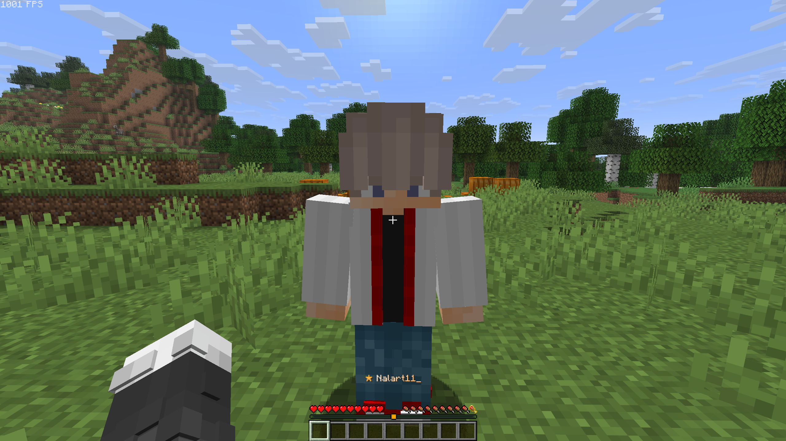

# Скрытие ников

Свой ник над головой можно скрыть командой `/toggle nickname-hidden`. Чтобы посмотреть имя другого игрока, подойдите и нажмите по нему ПКМ — имя появится над хотбаром примерно на 2 секунды. Shift для этого не обязателен; на игроке с эффектом невидимости подсказка не появится.

Это не скрывает вас в табе и не меняет псевдоним. Отображение настоящих имён вместо псевдонимов настраивается отдельно в [тогглах](/feature/toggles).

