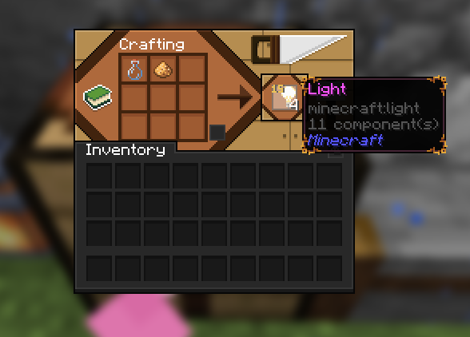
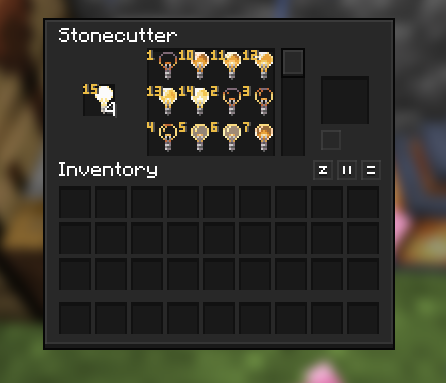

# Блок света

Освещение - не проблема, ведь был добавлен крафт Света в своём чистейшем виде

Пустая бутылочка и светопыль бесформенно дают 4 блока света. Уровень свечения также можно выбрать через Камнерез для большей гибкости ваших построек: один блок меняется на один блок выбранного уровня от 0 до 15. Уровень 0 не освещает.

:::gallery

:::
