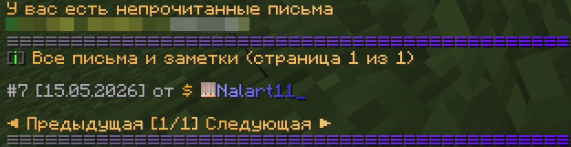
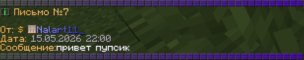

# Мейлы

Ваш друг ушёл, не сказав ни слова, а у вас для него важное сообщение? На сервере появилась возможность отправлять письма тем, кто на данный момент не в сети; человек получит его при следующем входе в игру. Отправлять, получать и пересматривать сообщения можно через команды `/mail`.

| Команда | Что делает |
| --- | --- |
| `/mail send <ник> <текст>` | Отправляет письмо офлайн-игроку или заметку себе |
| `/mail list [страница]` | Показывает письма, по 10 на странице |
| `/mail get <номер>` | Открывает доступное вам письмо |
| `/mail edit <номер> <текст>` | Меняет текст вашего письма |
| `/mail delete <номер>` | Удаляет ваше письмо |

При отправке в письме помещается до 200 символов. Редактировать и удалять можно только собственные письма; прочитать — автору и получателю. Игроку в сети вместо письма напишите [в личку](/feature/chat). Себе можно написать и онлайн — получится заметка на потом.

Для отправки почта должна быть включена у обоих игроков, а игнора не должно быть ни в одну сторону. При входе игра напомнит о новых письмах; отметка уведомления не означает, что человек уже прочитал текст.
