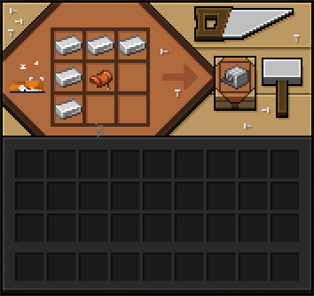
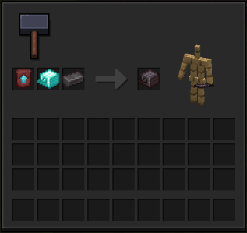

# Броня наутилуса

Хотите покататься на наутилусе, но он вечно подвергается нападениям, а искать броню для них - проблематично? Решение есть - теперь у защиты для подводного спутника есть полноценный крафт.

Для медной, железной, золотой и алмазной брони нужны 5 соответствующих слитков или алмазов и седло. Верхний ряд верстака заполните материалом, в среднем положите материал слева и седло в центре, в нижнем — материал слева. Получится одна броня.

Проверить зарегистрированный рецепт можно через `/crafts`. Незеритовое улучшение показано на старой иллюстрации ниже; если оно не появляется в игре, уточните его доступность у администрации — четыре добавленных рецепта сами по себе его не добавляют.

:::gallery

:::
