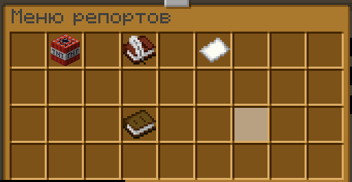

# Жалобы

Столкнулись с гриферством, чем-то непонятным или просто хотите задать вопрос администрации? Команда `/report` откроет меню обращений, где можно выбрать тип проблемы.

- **Гриферство** — сообщить о разрушении. К репорту автоматически прикладываются ваши текущие координаты.
- **Вопрос** — задать вопрос администрации.
- **Другое** — рассказать о любой другой проблеме.

После выбора откроется окошко, куда нужно вписать текст обращения. Репорт получит свой номер, а администрация - уведомление о нём. Всю историю своих обращений и ответы на них можно посмотреть там же, в кнопке **«Мои репорты»**.

Своё обращение можно повторно открыть командой `/report get <номер>`. Номер чужого репорта не даёт доступа к нему.

:::tip{title="Жалуетесь на гриф?"}

Отправляйте репорт, стоя прямо на месте разрушения - координаты прикрепятся сами, и администрации не придётся выяснять, где именно всё случилось. Когда на репорт ответят, вам придёт сообщение, по которому можно открыть ответ.

:::

В обращениях не нужно публиковать личные данные в общий чат. Если нужна приватная переписка вне игры, в Discord есть [тикеты](/feature/bots): жалоба, баг или заявка на роль. Это отдельная система, а не ещё один способ открыть тот же игровой репорт.
