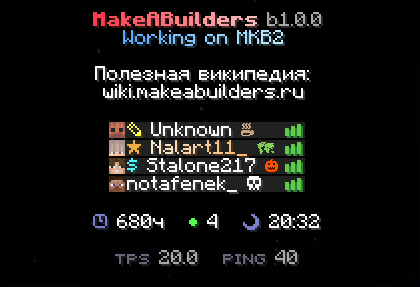

# Статусы

Теперь, дабы выделяться на фоне других, в табе существуют специальные "статусы". Они могут быть как декоративные, так и описывающие ваше времяпрепровождение. Всё управляется через /status

`/status` открывает меню выбора, `/status list` — список. На странице меню помещается 12 вариантов. Наведите на статус, чтобы прочитать его название, и выберите подходящий.

| Команда | Действие |
| --- | --- |
| `/status preview fishing` | Посмотреть пример, не меняя свой статус |
| `/status set fishing` | Поставить статус рыбалки |
| `/status clear` | Убрать статус |
| `/status custom <текст>` | Задать собственный статус при наличии доступа |

Кроме обычных значков есть меняющиеся статусы: `streak` показывает [дни подряд](/feature/streak), а `dimension` — измерение цветом: зелёный в обычном мире, красный в Незере, фиолетовый в Крае и серый в другом мире.

Собственный статус ограничен 1–3 символами; сложные emoji могут занимать несколько символов. Наличие доступа зависит от вашей роли. Статус `streaming` — только значок: [режим стримера](/feature/streamer-mode) включается отдельно. Значок `ping` тоже не заменяет числовой пинг в табе.
