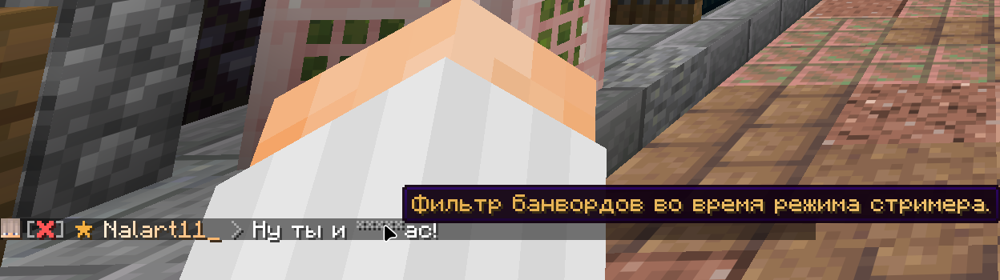

# Режим стримера

Иллюзия безопасности... для стримера

Как вы знаете, у нас на сервере разрешены банворды... а что насчёт стримеров - как им быть?

Всё просто! Специально для стримеров был создан "режим стримера", фильтрующий отображение сообщений по словарю. Включается и выключается через `/toggle streamer-mode` или [меню настроек](/feature/toggles). Он меняет то, что видите вы, а не удаляет исходные сообщения у всех.
