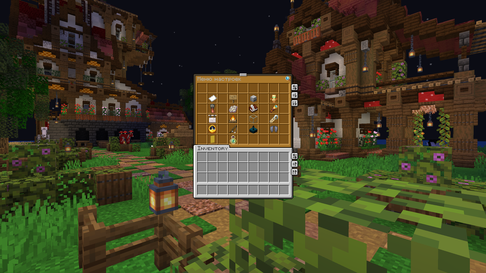

# Тогглы

Небольшой набор функций, которые можно настроить под себя

Иногда хочется отдохнуть ото всех окружающих... и в том числе для этого были сделаны тогглы.
Мы предлагаем вам сборник персональных настроек, помогающих добиться полного комфорта. Эти тогглы свободно переключаются в зависимости от вашего усмотрения.
Откройте `/toggle` или `/toggle menu` и нажмите нужную настройку. `/toggle list` покажет интерактивный список в чате. Можно обойтись без меню: `/toggle fishing` переключит улучшенную рыбалку, а `/toggle get fishing` покажет её состояние. Дописывать `true` или `false` не нужно.

| Настройка | Ключ команды | По умолчанию |
| --- | --- | --- |
| Личные сообщения | `direct-messages` | Вкл. |
| Общий чат | `global-messages` | Вкл. |
| Смерти других игроков | `death-messages` | Вкл. |
| Достижения других игроков | `advancement-messages` | Вкл. |
| Вход и выход других игроков | `session-messages` | Вкл. |
| Спавн фантомов на себе | `phantoms` | Выкл. |
| [Почта](/feature/mail) | `mail` | Вкл. |
| [Режим стримера](/feature/streamer-mode) | `streamer-mode` | Выкл. |
| [Пузырьки сообщений](/feature/bubble) | `bubble-messages` | Вкл. |
| Уведомления о [стрике](/feature/streak) | `streak-messages` | Вкл. |
| [Скрытие имени над головой](/feature/hidden-name) | `nickname-hidden` | Выкл. |
| Настоящие ники других игроков | `show-real-nicknames` | Выкл. |
| Время сообщений в чате | `time-of-sending-message` | Выкл. |
| [Улучшенная рыбалка](/feature/fishing) | `fishing` | Вкл. |
| Пинг игроков в табе | `ping` | Вкл. |
| Скорость и угол на элитрах | `elytra-speed` | Вкл. |
| [Флаг клана в табе](/feature/clans) | `clan-status` | Выкл. |
| Босс-бар со статистикой сервера | `state-boss-bar` | Выкл. |

Это начальные значения, а не сброс ваших сохранённых настроек. Уведомления о собственных входе, смерти и достижениях этими фильтрами не скрываются. Включённые фантомы лишь разрешают их обычный спавн на вас: не вызывают их сразу и не защищают от фантомов других игроков.

На элитрах показываются скорость в м/с и угол полёта. Босс-бар выводит TPS, ваш пинг и время работы сервера; заполнение и цвет полосы отражают время обработки тика: белый до 40 мс, жёлтый выше 40 и красный выше 55.

Флаг клана заменяет обычный статус у ваших соклановцев в вашем табе, а не копирует рисунок кланового баннера. Настоящие ники меняют то, как **вы** видите других игроков, а не ваш собственный ник.
